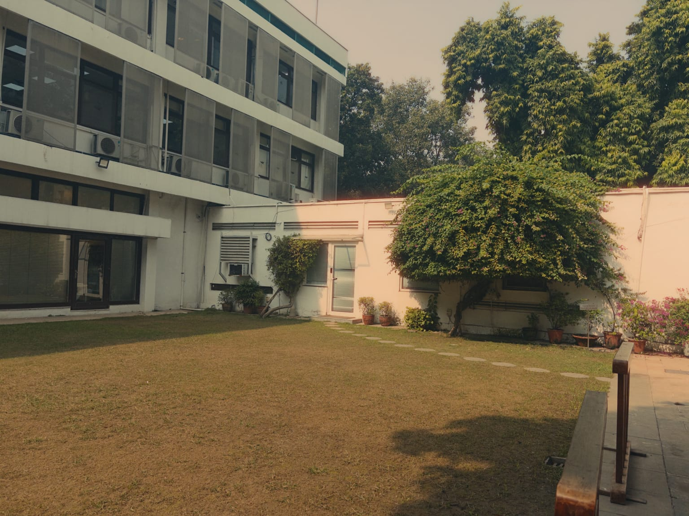
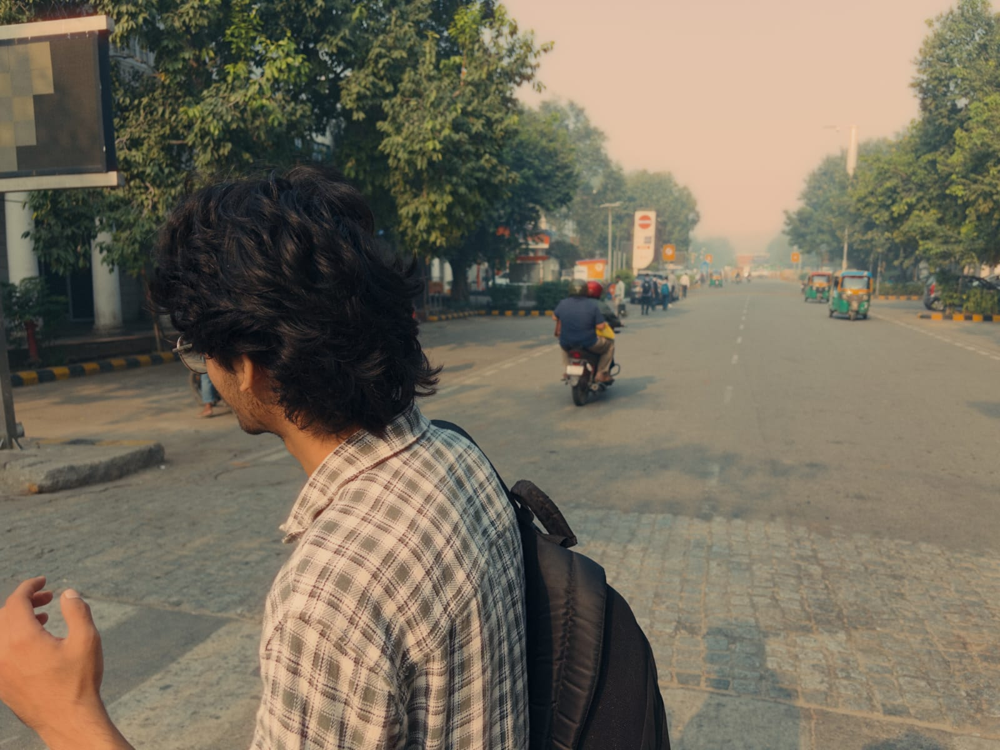
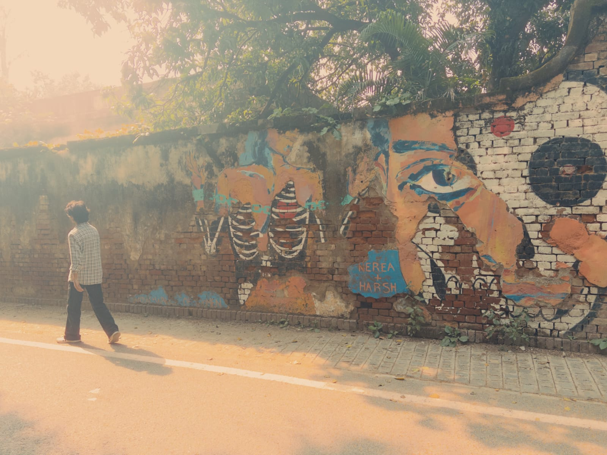

+++
title = "shutters"
date = 2026-11-10
template = "post.html"
+++

I’ve been trying to find some way to close these window shutters without asking someone to do it because I want these shutters closed; I want to have a view of the outside while I am sitting here in this library. The view is quite simple, not everchanging, but good.

I like coming here—matter of fact, this might be the only place I love to come to in Delhi among some other places that I like. There was a renovation of the entire interior some months back. Now the sitting area is a little open, not as confined as it used to feel before because of that bookshelf behind the first row and the last row of the sitting area, and the area between rows was less, maybe. Then, maybe a dozen computers were at the left side of the room beside the sitting area itself, but now that the computer area is completely replaced with a different sitting area and the bookshelves are moved to the back of the entire sitting area, it now feels more spacious. They moved the office thingie that was at the back of the room to right next to the door. They moved the sofa and television too; now it’s after the sitting area between bookshelves. I don’t really know what a library needs a television for, but before, it was connected to a PS4. Don’t know what happened to that PS4, tho.

There is this book “Physiker” on the bookshelf diagonally across the seat I have occupied; the cover looks quite intriguing, but I think it’s written in Deutsch (German). It’s a German library, after all, and I am quite very new to their language. But anyways, the whole renovation is to my liking.

One of the best things about the library is how I always make my way here. I usually drop off at the usual metro station, from there move around in circles around the whole plaza thing or whatever one might call it. The structures here look all the same, so I/we just keep moving in circles until you see a fountain at the centre of a fourway road, then follow a direction until you see another fountain at the centre of a three-way road with a McDonald’s nearby around there, then go along the road where you see flags of different countries—it’s a visa institute or smth. Keep going straight; after some time, you will find it if that’s where you want to go.

"its like you're trying to get to heaven in a hurry, and the queue was shorter than you thought it'd be, and the doorman says , "you need to get a wristband"..." - Alex Turner (its hard to get around the wind)
